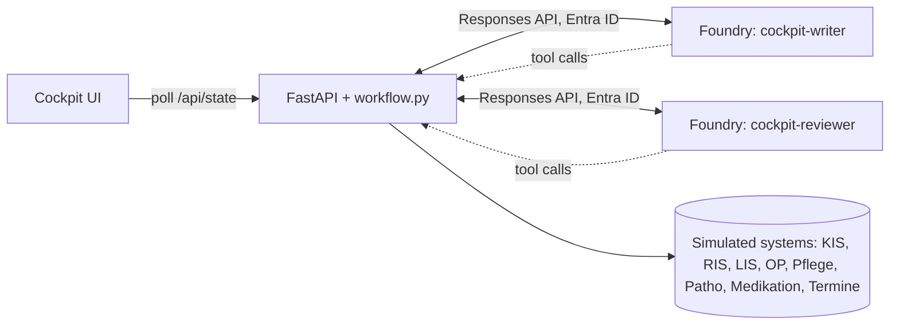

# Klinik Cockpit · KI-Agenten

A lean, agent-centred demo for hospital CIOs: two real Microsoft Foundry agents prepare and
check a discharge letter from eight simulated hospital systems, react to a new system event on
their own, and hand over to a physician for **one** final approval.

It replaces the earlier, approval-heavy cockpit for presentations; that one is archived in
[`archive/klinik-cockpit-v1/`](../archive/klinik-cockpit-v1/README.md). All data is fictional (patient Elena Novak, the same synthetic
patient as the voice demo).

German presenter script: [docs/KLINIK-SCRIPT-DE.md](../docs/KLINIK-SCRIPT-DE.md) · Setup guide:
[docs/KLINIK-SETUP.md](../docs/KLINIK-SETUP.md).

## Demo flow (about 6 minutes)

1. **Start:** "Entlassbrief mit KI-Agenten erstellen". The **Dokumentations-Agent** lists the
   sources and reads all nine in parallel (KIS, radiology, lab, OR report, nursing, pathology,
   medication module, appointments). The live log shows every real tool call.
2. **Gaps are recognised, not guessed:** the medication plan is still in pharmacy review
   (content withheld), the histology is pending. Both become open points; the medication section
   says the plan is not released yet.
3. **Agent checks agent:** the **Prüf-Agent** (different, stronger model) reads the sources
   itself and checks every statement. Errors (e.g. a missing appointment time) go back to the
   writer, who corrects them automatically; corrected sections are marked.
4. **Event:** "⚡ Demo-Ereignis: Stationsapotheke gibt Medikationsplan frei". The writer re-reads
   only the released plan, updates only the medication section (highlighted, previous version
   available), and the reviewer checks again.
5. **One approval:** "Brief prüfen und freigeben" → confirm. The draft becomes the finished
   doctor's letter: letterhead, GP recipient, salutation, signature marked "elektronisch
   freigegeben", and a QR code for the patient that opens the voice demo.
6. **Sending (simulated):** "Per KIM an Hausarztpraxis" (eArztbrief via the Telematikinfrastruktur),
   "In ePA einstellen", and "Patientenexemplar drucken" (browser print of the final letter).

The letter's facts (medication, appointments, warning signs, contacts) match the voice demo's
letter, so the story continues seamlessly in the Entlass-Assistent.

Every source chip opens the original text. Agent time is about 30–45 s for the first draft and
15–30 s for the update.

## What is real

- Two Foundry prompt agents, created as code ([create_agents.py](create_agents.py)):
  `cockpit-writer` (default `gpt-4.1`, fast) and `cockpit-reviewer` (default `gpt-5.5`,
  thorough). Both return strict JSON ([agents.py](agents.py)).
- Client-executed function tools `list_patient_sources` and `read_source`
  ([workflow.py](workflow.py)); unreleased content is never returned to the agents.
- Server-side validation of every draft: six sections, all sources read, citations only to read
  and released sources, open points for every pending/unreleased source. Failed checks are sent
  back to the agent for correction (visible in the log), never silently fixed.
- Writer ↔ reviewer loop with up to two correction rounds; the final verdict is shown.

Simulated: the hospital systems and their data, the pharmacy release event, KIM/ePA sending and
KIS storage. The approval is a demo state, not a qualified electronic signature.



## Run it (Windows)

```powershell
Copy-Item .env.example .env      # endpoint, tenant, model deployment names
az login --tenant <tenant-id>
python -m venv .venv
.\.venv\Scripts\python.exe -m pip install -r requirements.txt
.\.venv\Scripts\python.exe create_agents.py   # creates agent versions, writes .agents.json
.\Start-AgentCockpit.ps1
```

Open <http://127.0.0.1:8020/>. Requires existing deployments of both models (structured
outputs) and the **Foundry User** role. Use **↺ Zurücksetzen** before each run.

Checks:

```powershell
.\.venv\Scripts\python.exe -m pytest -q     # local, no Azure calls
.\.venv\Scripts\python.exe e2e_test.py     # live: draft -> event update -> approval, safety checks
```

## Boundaries

Demonstration only, not a medical device; never use real patient data. The local server has no
user authentication; keep it on loopback. Agent instructions and server validation reduce, but
do not eliminate, model errors; the physician's review and approval remain essential.
