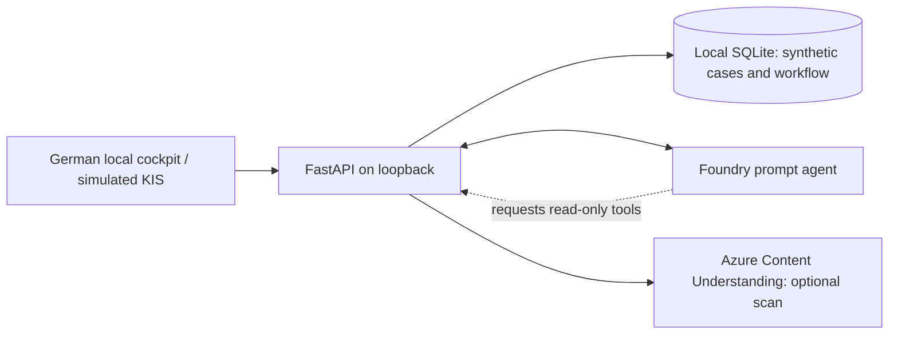
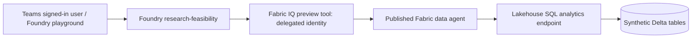

# Architecture, access, and demo boundaries

## Clinical documentation

The agent requests document inventory, workflow state, individual originals,
laboratory status, and follow-up context. The local backend executes read-only
functions and returns case-scoped results. It validates source references and
proposal shape, not medical correctness.

Human actions release a simulated medication plan, accept text, assess
findings, assign a demo role, complete a task, approve a draft, and copy it into
the simulated KIS. Approval is not a medical signature. Existing copied
versions remain immutable. A source change invalidates applicability of
older proposals. Revision checks guard concurrent local edits.

The optional scan chapter uses real extraction on a generated fictional
external consultation report. Source acceptance checks case association and
requires explicit human confirmation. The later laboratory result comes from
the simulated LIS. Automatic new-source processing is local application
orchestration, not a Foundry routine or autonomous hospital operation.

The local server has no end-user authentication, trusted reviewer identity,
or per-user authorization. Reviewer labels and audit records are demo state,
not a protected clinical audit trail. **Do not expose it to a network.**

## Research feasibility

This route does not depend on a laptop-hosted callback. The local research
scripts generate, provision, and independently verify the data; they are not
the live Teams query server.

Five generated tables represent patients, surgery episodes, laboratory
observations, follow-up/outcomes, and sites. The agent's selected analysis
sources are **research_episodes** and **research_sites**. Episode fields
already contain the prepared preoperative measurement and follow-up values.
No ontology, semantic model, literature retrieval, or real hospital feed is
configured.

Each distinct patient is eligible if any episode meets all criteria. If none
qualifies, but at least one potentially qualifying episode has unknown
criteria, the patient is unassessable. Otherwise the patient is excluded.
A known failed criterion takes precedence over missing values within an
episode. Counts cover the full synthetic population rather than prefiltering
away excluded people.

The user must pass app availability, Foundry invocation, and Fabric
authorization independently. Workspace Viewer is a broad read role across
workspace items, not an aggregate-only database restriction. Agent refusal of
individual identifiers is a behavior guardrail, not a security guarantee.

## Before any real hospital use

Separately design and approve clinical ownership and intended purpose,
regulatory assessment, privacy/legal basis, identity and per-record access,
source integration and reconciliation, retention/deletion, protected audit,
monitoring, validation, incident response, and safe signing/write-back.

Verify service regions, model deployment SKU/routing, contractual commitments,
and the complete processing path. A resource in an EU region does not by
itself guarantee Germany-only or EU-only inference. These demonstrations
make no GDPR-compliance, medical-device, or clinical-validation claim.

## Public repository contents

Only reusable source, synthetic templates/generation logic, dependency
manifests, tests, and generic documentation belong here. Environment settings,
runtime data, account screenshots, authentication artifacts, Teams ZIPs, and
internal presentation decks are deliberately excluded.
