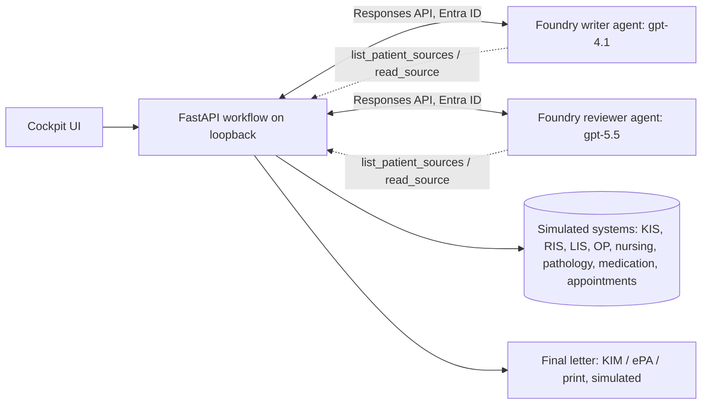
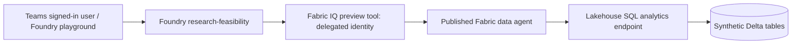
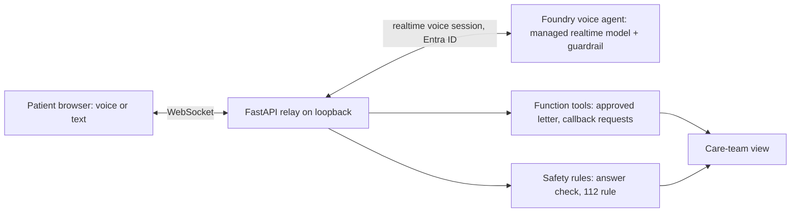

# Architecture, access, and demo boundaries

## Clinical documentation (Klinik Cockpit · KI-Agenten)

Two prompt agents with strict JSON output schemas run in sequence. The writer
lists and reads the sources through client-executed function tools and drafts six
letter sections with source citations and open points. The reviewer, a different
and stronger model, reads the sources itself and checks every statement; its
errors go back to the writer (at most two correction rounds).

The server, not the model, enforces the boundaries: unreleased or pending source
content is never returned to the agents, and each draft is validated (six
sections, all required sources read, citations only to read and released sources,
an open point for every pending or unreleased source, no stale open points).
Failed checks go back to the agent visibly in the log; nothing is silently fixed.
It validates structure and sourcing, not medical correctness.

A simulated event (the ward pharmacy releases the medication plan) makes the
writer re-read only that source and update only the affected section, followed by
another review. One human approval turns the draft into the final doctor's letter
with a QR code for the patient. Sending via KIM, ePA upload and storage are
simulated; approval is a demo state, not a qualified electronic signature.

State lives in memory. The local server has no end-user authentication or
per-user authorization. **Do not expose it to a network.** The earlier
approval-heavy cockpit is archived in `archive/klinik-cockpit-v1/`.

## Research feasibility

This route does not depend on a laptop-hosted callback. The local research
scripts generate, provision, and independently verify the data; they are not
the live Teams query server.

Five generated tables represent patients, surgery episodes, laboratory
observations, follow-up/outcomes, and sites. The agent's selected analysis
sources are **research_episodes** and **research_sites**. Episode fields
already contain the prepared preoperative measurement and follow-up values.
No ontology, semantic model, literature retrieval, or real hospital feed is
configured.

Each distinct patient is eligible if any episode meets all criteria. If none
qualifies, but at least one potentially qualifying episode has unknown
criteria, the patient is unassessable. Otherwise the patient is excluded.
A known failed criterion takes precedence over missing values within an
episode. Counts cover the full synthetic population rather than prefiltering
away excluded people.

The user must pass app availability, Foundry invocation, and Fabric
authorization independently. Workspace Viewer is a broad read role across
workspace items, not an aggregate-only database restriction. Agent refusal of
individual identifiers is a behavior guardrail, not a security guarantee.

## Patient voice assistant (Entlass-Assistent)

The patient opens the page from a QR code on their copy of the approved
doctor's letter (the same letter the cockpit agents produce; identity check
simulated). The voice agent has no letter content in its
instructions: it must call `get_discharge_information` for approved sections
and may only rephrase, explain medical jargon in plain words, or translate them. Medication changes, questions the
letter doesn't answer, and warning signs create callback requests with a German
summary; acute danger signs trigger an immediate 112 instruction. The browser
never receives a token; the relay holds the credential, executes the tools, and
reconnects automatically if the realtime connection drops.

Spoken translations are not clinically validated. Production use would need
patient-portal identity, letters from the hospital system, a real ward worklist,
clinically approved emergency wording, and HTTPS access for phones.

Safety layers against medical advice and medication mix-ups (none is a guarantee
alone):

- **Architecture:** facts only through the letter tool; no tool can change treatment;
  the medication card is rendered from the approved letter, not from the model.
- **App rules** (`safety.py`), applied to each answer while it streams: drug names and
  doses must match the letter (right dose for the right drug), no other drugs unless the
  patient named them, no advice phrases. A violating answer is stopped before it is fully
  spoken, the team gets a safety request, and the agent answers again. Acute danger
  terms in five languages show the 112 notice by rule. Word lists and patterns are
  auditable but incomplete.
- **Foundry guardrail** (preview, `rai_config` on the agent): content harms, Prompt
  Shields, Task Adherence on tool calls, and a custom blocklist with the same advice
  phrases. In the reference build it was enforced for a text prompt agent but not in
  realtime voice sessions; re-test before relying on it. Task Adherence checks whether
  a tool call fits the request; it doesn't detect advice in spoken text. Groundedness
  detection isn't available for agents.
- **Tests:** unit tests for the rules, live smoke test, and an end-to-end test that
  injects a wrong dose.

A patient-facing assistant with medical content requires a regulatory assessment
under the EU Medical Device Regulation (MDR, 2017/745) and clinical validation.

## Before any real hospital use

Separately design and approve clinical ownership and intended purpose,
regulatory assessment, privacy/legal basis, identity and per-record access,
source integration and reconciliation, retention/deletion, protected audit,
monitoring, validation, incident response, and safe signing/write-back.

Verify service regions, model deployment SKU/routing, contractual commitments,
and the complete processing path. A resource in an EU region does not by
itself guarantee Germany-only or EU-only inference. These demonstrations
make no GDPR-compliance, medical-device, or clinical-validation claim.

## Public repository contents

Only reusable source, synthetic templates/generation logic, dependency
manifests, tests, and generic documentation belong here. Environment settings,
runtime data, account screenshots, authentication artifacts, Teams ZIPs, and
internal presentation decks are deliberately excluded.
