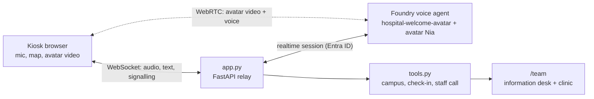

# Empfangs-Avatar: welcome and wayfinding avatar for a hospital

A kiosk at the main entrance of the fictional *Universitätsklinikum Musterstadt*. Visitors talk to
**Nia**, a photorealistic avatar, in their own language: she shows the way on a campus map, checks
patients in for today's outpatient appointment, answers practical questions (visiting hours,
cafeteria, parking, wheelchairs), and calls a colleague from the information desk when needed.
She gives **no medical information**: the use case stays administrative.

It continues the patient journey of the other demos: on 24.11.2026 at 10:12, Elena Novak arrives
for the follow-up appointment from her discharge letter (Chirurgische Ambulanz, Gebäude A,
Ebene 2, 10:30). The demo is technically independent.

German presenter script: [docs/AVATAR-SCRIPT-DE.md](../docs/AVATAR-SCRIPT-DE.md) · Setup guide: [docs/AVATAR-SETUP.md](../docs/AVATAR-SETUP.md).

## Demo flow (about 5 minutes)

1. Open <http://127.0.0.1:8030/> full screen and tap **Termin anmelden** (or the microphone).
   Nia appears and greets you.
2. Say *"Novak, geboren am 14. März 1959."* The screen shows the check-in ticket (waiting number,
   time, what to bring) and the route; the outpatient clinic sees the arrival on `/team`.
3. Switch language just by speaking, e.g. Ukrainian: *"Я в інвалідному візку. Де здати кров?"*
   The screen follows the language, the route is step-free.
4. Ask a medical question (*"Soll ich noch eine Ibuprofen nehmen?"*): no advice, a colleague is
   called instead.
5. Optional emergency: *"My father collapsed and has chest pain!"* A rule alarms staff at once.
6. Open <http://127.0.0.1:8030/team>: check-ins with the internal note (only for staff), help
   requests, and conversation transcripts.

## What is real

- A native Foundry **voice agent** with a **standard video avatar** (`nia`), managed realtime model
  and multilingual HD voice, created as code in [create_agent.py](create_agent.py).
- Avatar video and voice are streamed to the browser over **WebRTC**; [app.py](app.py) only relays
  the signalling (ICE servers, SDP offer/answer) and keeps the Entra ID credential on the server.
- **Client-executed function tools** ([tools.py](tools.py)): `find_location`, `check_in_appointment`,
  `get_visitor_information`, `call_staff`. Each call also carries the visitor's language, so the
  kiosk screen follows the conversation.
- Rule-based alarm ([safety.py](safety.py)): acute danger terms in five languages call staff, even
  if the model doesn't react.

Simulated: campus, appointments and visitor information ([campus.json](campus.json)), the hospital
appointment system, staff notification, and the demo clock (24.11.2026, 10:12).



## Privacy and safety by design

- Check-in needs last name **and** date of birth; wrong details reveal nothing.
- The appointment reason stays internal: the tool never returns it, so the avatar can't say it in
  the foyer. Staff see it on `/team`.
- No medical content; health concerns lead to `call_staff` (urgent). In an emergency the avatar
  says "stay here, help is coming" instead of sending people walking.
- The kiosk returns to the welcome screen 45 seconds after a conversation ends.

## Run it (Windows)

```powershell
Copy-Item .env.example .env      # set FOUNDRY_PROJECT_ENDPOINT and AZURE_TENANT_ID
az login --tenant <tenant-id>
.\Start-AvatarDemo.ps1 -Install   # first run: creates .venv and installs dependencies
.\.venv\Scripts\python.exe create_agent.py   # creates a new agent version with the avatar
.\Start-AvatarDemo.ps1
```

Requires the **Foundry User** role on a project in a region with voice agents **and** real-time
avatars (e.g. Sweden Central, West Europe), Python 3.11+, and Edge or Chrome. Avatars are billed
separately. Port 8030 avoids clashing with the other demos.

Checks:

```powershell
.\.venv\Scripts\python.exe -m pytest -q       # local, no Azure calls
.\.venv\Scripts\python.exe smoke_test.py     # live, app running: 8 typed cases in 5 languages (voice-only mode)
```

The smoke test pauses 40 seconds between sessions: the avatar service rate-limits sessions opened
back to back ("Avatar request was rate-limited"). Avatar video, microphone and voice need a manual
test in the browser.

## Boundaries

Demonstration only; all data is fictional. The local server has no user authentication; keep it
on loopback. A real kiosk would need the hospital's appointment system, a staff paging integration,
accessibility review (screen height, wheelchair reach, hearing loop), and a data protection
assessment for audio processing in a public area.
