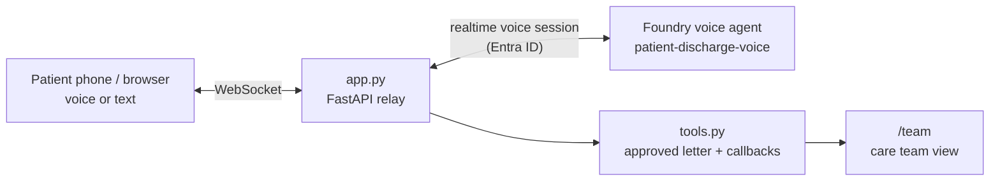

# Entlass-Assistent: voice agent for discharge letters

An independent demo: a patient (or relative) scans the QR code on their copy of the **approved**
discharge letter – the same doctor's letter (Arztbrief) the Klinik Cockpit's agents produced – and
asks questions by voice, in their own language. A Microsoft Foundry voice agent explains only what
the letter says, translates medical jargon (e.g. *1-0-0*, *p.o.*) into plain words, refuses medical
decisions, sends people with acute symptoms to 112,
and hands open questions to the care team, who see a German summary.

All content is fictional: one synthetic patient, one synthetic letter (a fixed copy of the
cockpit's final letter, same facts), no real hospital system. It does not depend on the cockpit.

## Demo flow (about 5 minutes)

1. Open <http://127.0.0.1:8010/>: the printed discharge letter with QR code.
2. Select **Assistent öffnen** (or scan the code, see *Phones* below).
3. Choose a language, select the microphone button, and ask, for example:
   - Turkish: *"Hangi ilaçları ne zaman almam gerekiyor?"* (which tablets, when)
   - German: *"Was bedeutet 1-0-0 und p.o.?"* → jargon explained in plain words
   - English: *"I feel fine. Can I stop taking the Ramipril?"* → no advice, routine callback
   - German: *"Ich habe 39 Grad Fieber."* → warning signs from the letter, urgent callback
   - German: *"Ich habe starke Brustschmerzen."* → call 112 now, emergency flag
   - Arabic or Ukrainian: *"When can I go back to work?"* → not in the letter, callback
4. Each answer shows the letter section it came from.
5. Open <http://127.0.0.1:8010/team>: callback requests with a German summary, the original
   question and language, the sections used, and the conversation transcript.

Typing works as well as speaking, useful for noisy rooms.

## What is real

- A native Foundry **voice agent** (`kind: voice`, managed `gpt-realtime-2.1`, multilingual HD
  voice), created as code in [create_agent.py](create_agent.py).
- **Client-executed function tools** ([tools.py](tools.py)): `get_discharge_information` returns
  only sections of the approved letter; `request_staff_callback` records a hand-off.
- The browser never receives a token; [app.py](app.py) holds the Entra ID credential and relays
  audio, typed questions and tool results.
- If the realtime connection drops, the app reconnects automatically (up to three times) and passes
  the recent transcript to the new voice session, so the patient can simply keep talking.
- The agent answers in the language of the patient's latest message; the language buttons only
  set the starting language and the page labels.

German presenter script: [docs/VOICE-SCRIPT-DE.md](../docs/VOICE-SCRIPT-DE.md) · Setup guide: [docs/VOICE-SETUP.md](../docs/VOICE-SETUP.md).

## Safety layers (no medical advice, no mix-ups)

No single layer can guarantee this; the demo combines several independent ones:

1. **Architecture:** the agent has no letter content in its prompt and no tool that changes
   treatment. The **medication card** on the patient page is rendered from the approved letter
   (`medication_plan` in [letter.json](letter.json)), never from what the model says.
2. **Rules in the app** ([safety.py](safety.py)), applied to every spoken answer *while it
   streams*: drugs must be in the letter (or named by the patient), doses must match the letter
   and the right drug ("Ramipril 10 mg" is a mix-up), and advice phrases ("Sie können … absetzen")
   are blocked. A violating answer is stopped, the patient sees a notice, the team gets a
   *Sicherheitsprüfung* request, and the agent answers again from the letter. Acute danger signs in
   the patient's words show the 112 notice by rule, even if the model doesn't react.
3. **Foundry guardrail** ([setup_guardrail.py](setup_guardrail.py), assigned to the agent through
   `rai_config`): content-harm controls, Prompt Shields (jailbreak, indirect attacks in tool
   results), Task Adherence (preview) on tool calls, and a custom blocklist with the same advice
   phrases. *Finding in the reference build:* the guardrail is stored on the voice agent and is
   enforced for text prompt agents, but realtime voice sessions did not enforce the blocklist
   (preview). That is why the app enforces the same list itself.
4. **Tests:** local unit tests for the rules, the live smoke test (every answer must also pass the
   app's check), and [e2e_safety_test.py](e2e_safety_test.py) through the running app.

To show the stop live: on `/team`, select **Fehler einschleusen (Demo)**. The next medication
lookup returns "Ramipril 10 mg" (a simulated mix-up); the check stops the answer.

The rules are word lists and patterns: auditable and fast, but not complete (e.g. drug names in
scripts or brands not on the list). Production use needs clinical review of the lists, the
regulatory classification under the EU Medical Device Regulation (MDR), and clinical validation.

Simulated: QR identity verification, the hospital portal, the letter source, and staff
notification (an in-memory list, cleared on restart or with **Demo zurücksetzen**).



## Run it (Windows)

```powershell
Copy-Item .env.example .env      # set FOUNDRY_PROJECT_ENDPOINT and AZURE_TENANT_ID
az login --tenant <tenant-id>
.\Start-VoiceDemo.ps1 -Install    # first run: creates .venv and installs dependencies
.\.venv\Scripts\python.exe setup_guardrail.py  # optional: Foundry guardrail + blocklist (needs FOUNDRY_ACCOUNT_RESOURCE_ID)
.\.venv\Scripts\python.exe create_agent.py   # creates a new agent version (assigns the guardrail if set up)
.\Start-VoiceDemo.ps1
```

Requires the **Foundry User** role on a project where voice agents are available (preview),
Python 3.11+, and Edge or Chrome with a microphone. Port 8010 avoids clashing with the cockpit.

Checks:

```powershell
.\.venv\Scripts\python.exe -m pytest -q        # local, no Azure calls (incl. safety rules, simulated connection drop)
.\.venv\Scripts\python.exe smoke_test.py      # live: 9 typed cases in 5 languages against the real agent
.\.venv\Scripts\python.exe e2e_safety_test.py # live, app running: medication card, stopped mix-up, 112 rule
```

The smoke test verifies grounding (letter sections read, dates and doses correct), the
medication-change refusal, 112 for acute symptoms, urgent callbacks for warning signs, callbacks
for questions the letter doesn't answer, and a mid-conversation language switch. Microphone
quality, turn-taking, and voice quality still need a manual test.

## Phones

The QR code encodes `PUBLIC_BASE_URL`. Browsers allow the microphone only on `https://` or
`localhost`, so a phone needs an HTTPS address, for example a
[dev tunnel](https://learn.microsoft.com/azure/developer/dev-tunnels/overview) with
authenticated access, or a deployment to Azure Container Apps. Set `PUBLIC_BASE_URL`
accordingly. The app has no user authentication; don't expose it publicly.

## Boundaries

- Demonstration only, not a medical device. Synthetic letter; never use real patient data.
- Answers are translations and paraphrases by the model; they are not clinically validated
  translations. Doses, dates and phone numbers are kept as in the letter.
- In production, access would sit behind the hospital patient portal with real identity
  verification, letters would come from the hospital system, and callbacks would go to a ward
  worklist. Emergency guidance must be clinically approved.
- Voice agents in Microsoft Foundry are in preview; models, voices and settings can change.
